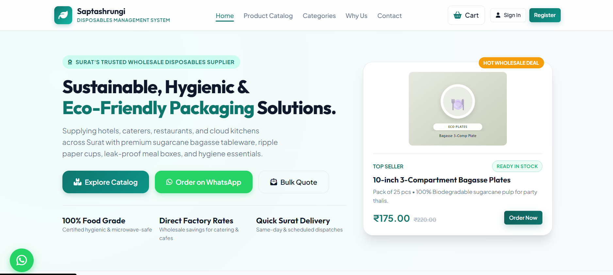
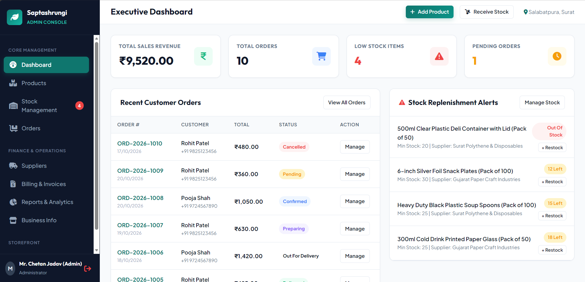

# Saptashrungi Disposables Management System (SDMS)

[](https://render.com/deploy?repo=https://github.com/VEER-cloud307/SDMS)

A full-featured management and ordering platform for disposable products and food packaging wholesale businesses, built for **Saptashrungi Disposables** (Surat, Gujarat).

---

## 📌 Features

### Public Storefront & Customer Portal
- **Product Catalog**: Browse eco-friendly paper cups, bagasse plates, takeaway meal containers, wooden cutlery, foil rolls, and hygiene supplies.
- **Search & Filter**: Filter by category, price, and search keywords.
- **Interactive Cart & Checkout**: Add items, set quantities, review cart totals, and place orders with real-time validation.
- **Order Tracking**: Track order status (Pending, Confirmed, Preparing, Out for Delivery, Delivered).
- **Customer Authentication**: Secure customer registration and login with JWT and bcrypt password hashing.
- **Customer Enquiries**: Contact and inquiry submission form for bulk/custom orders.

### Admin Dashboard & Management Panel
- **Overview Dashboard**: High-level KPI cards for total sales, orders, low-stock warnings, and recent activity.
- **Product Management**: Create, edit, and manage products, categories, pricing, stock thresholds, and upload product images.
- **Inventory & Stock Management**: Real-time stock level monitoring, minimum stock alerts, and incoming supplier shipment tracking.
- **Order Processing**: Review incoming orders, update statuses, auto-deduct stock upon confirmation, and view itemized order details.
- **Supplier Directory**: Manage wholesale vendors, supplier contacts, and linked product lines.
- **Billing & Invoices**: Generate printable, GST-compliant tax invoices and receipts with one-click print/PDF download.
- **Sales & Financial Reports**: Filter revenue, order volumes, best-selling items, and export reports.
- **Business Profile Settings**: Manage shop contact details, WhatsApp ordering number, and business address.

---

## 🛠️ Tech Stack

- **Backend**: Node.js, Express.js
- **Authentication & Security**: JSON Web Tokens (JWT), bcryptjs
- **File Uploads**: Multer
- **Database**: Dual-engine support:
  - **SQLite** (`better-sqlite3`) — Zero-config, fast local database file (default)
  - **MySQL / MariaDB** (`mysql2`) — Production-grade relational database
- **Frontend**: Clean, modern Vanilla HTML5, CSS3, JavaScript (Fetch API, responsive layouts)

---

## 🚀 Getting Started

Follow these steps to set up and run the application locally:

### 1. Prerequisites
- [Node.js](https://nodejs.org/) (v20 or higher recommended)
- [npm](https://www.npmjs.com/)

### 2. Installation
Clone the repository and install dependencies:
```bash
git clone https://github.com/VEER-cloud307/SDMS.git
cd SDMS
npm install
```

### 3. Environment Configuration
Create a `.env` file from the example template:
```bash
# On Windows PowerShell:
Copy-Item .env.example .env

# On Linux/macOS:
cp .env.example .env
```

Replace `JWT_SECRET` with a long, secure random value. You can generate a 64-character hex string with:
```bash
node -e "console.log(require('crypto').randomBytes(32).toString('hex'))"
```

Verify or adjust the `.env` settings as needed:
```env
PORT=3000
JWT_SECRET=your_generated_random_secret
DB_TYPE=sqlite
```

#### Optional: MySQL Database Configuration
If using MySQL or MariaDB instead of SQLite, set `DB_TYPE=mysql` and provide connection settings matching your local/server MySQL instance:
```env
DB_TYPE=mysql
DB_HOST=localhost
DB_PORT=3306
DB_USER=root
DB_PASSWORD=your_mysql_password
DB_NAME=sdms_db
```

### 4. Initialize Database & Seed Sample Data
Run the database initialization script to create tables and load sample products, users, categories, orders, and suppliers:
```bash
node database/init-db.js
```
*(Or run `npm run seed`)*

### 5. Start the Server
```bash
npm start
```
The server will start at: [http://localhost:3000](http://localhost:3000)

### 6. Accessing the Application
- **Storefront / Customer Portal**: [http://localhost:3000](http://localhost:3000)
- **Admin Dashboard**: [http://localhost:3000/admin](http://localhost:3000/admin)
- **Login Page**: [http://localhost:3000/login.html](http://localhost:3000/login.html)

---

## 🔑 Demo Login Credentials

The seed data (`database/seed.sql`) includes pre-configured demo accounts for testing:

| Role | Email | Password | Access Level |
| :--- | :--- | :--- | :--- |
| **Admin** | `admin@sdms.com` | `Admin@123` | Full access to Admin Panel & Storefront |
| **Customer** | `customer@sdms.com` | `Customer@123` | Customer ordering & cart |
| **Customer (Caterer)** | `pooja.caterers@gmail.com` | `Customer@123` | Customer ordering & cart |

> ⚠️ **Important Security Note**:
> These are demo login credentials intended solely for testing and evaluation. **You must change these passwords or remove demo accounts before using this system in production!**

---

## 📂 Project Structure

```text
sdms/
├── backend/
│   ├── middleware/      # Auth & file upload middleware
│   ├── routes/          # Express API route handlers
│   └── server.js        # Main Express application entry point
├── database/
│   ├── db.js            # Unified DB connector (SQLite & MySQL)
│   ├── init-db.js       # Database initialization & migration script
│   ├── schema.sql       # MySQL schema definitions
│   └── seed.sql         # Sample categories, products, orders & demo users
├── frontend/
│   ├── admin/           # Admin panel pages (dashboard, products, orders, etc.)
│   ├── css/             # Styling & responsive design
│   ├── images/          # Product SVG icons & brand assets
│   ├── js/              # Client-side scripts & API integration
│   ├── index.html       # Public product catalog & homepage
│   ├── cart.html        # Shopping cart & checkout
│   ├── orders.html      # Customer order tracking
│   └── login.html       # Authentication (Login & Signup)
├── .env.example         # Template for environment variables
├── .gitignore           # Git ignore patterns
├── package.json         # Project metadata and dependencies
└── README.md            # Project documentation
```

---

## 📸 Screenshots





---

## 📄 License
ISC License
